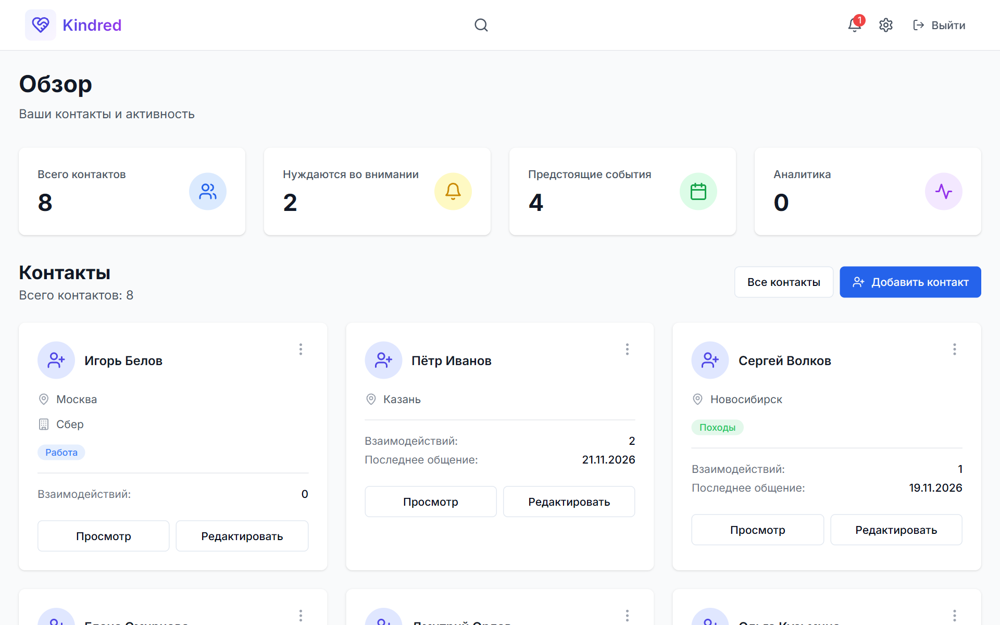
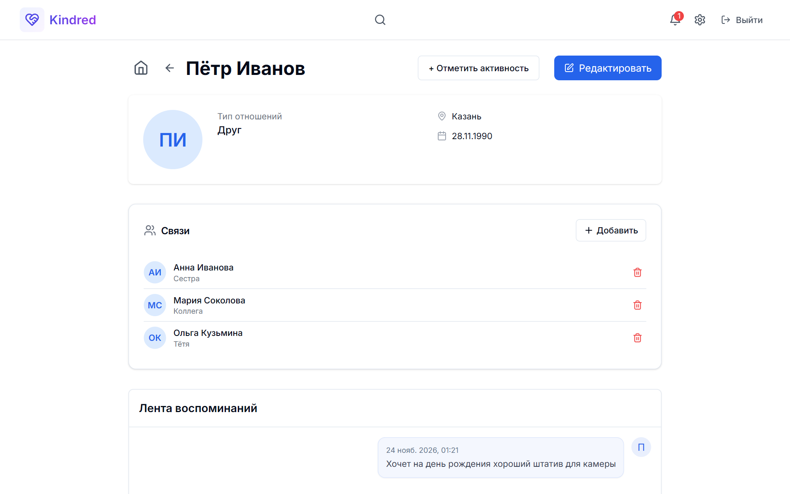
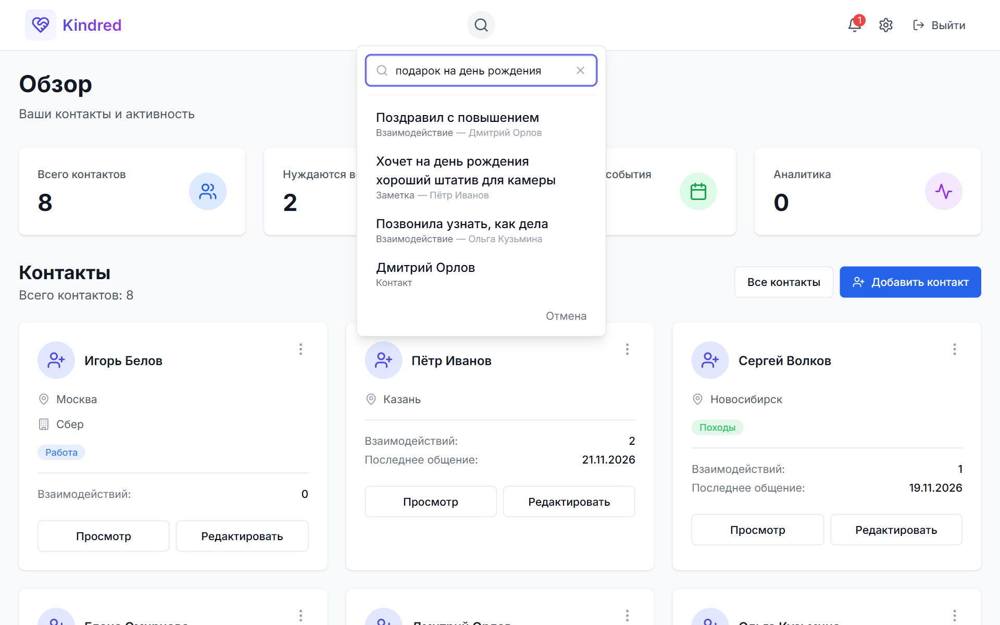
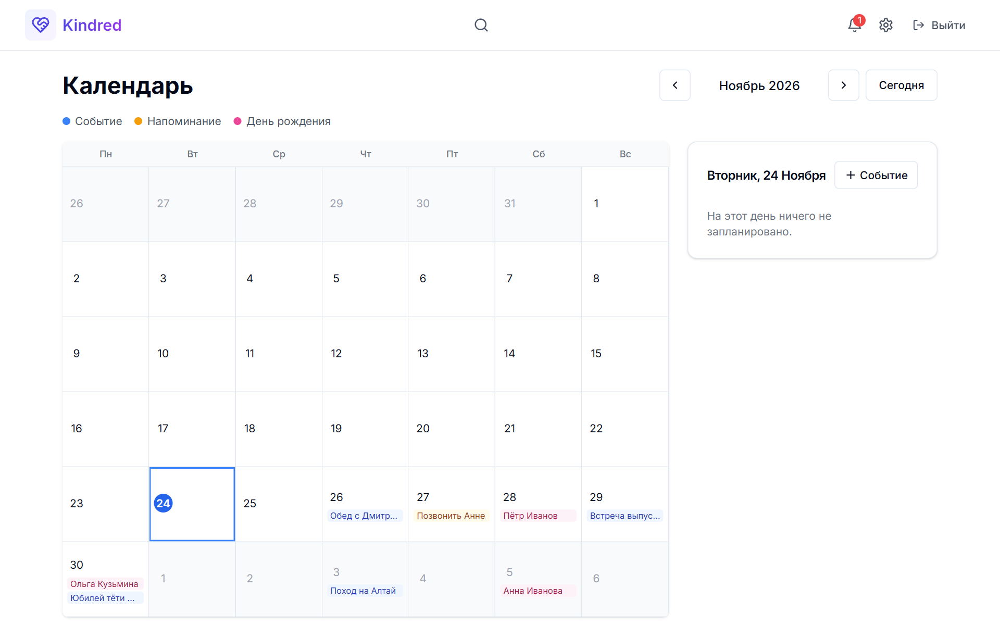
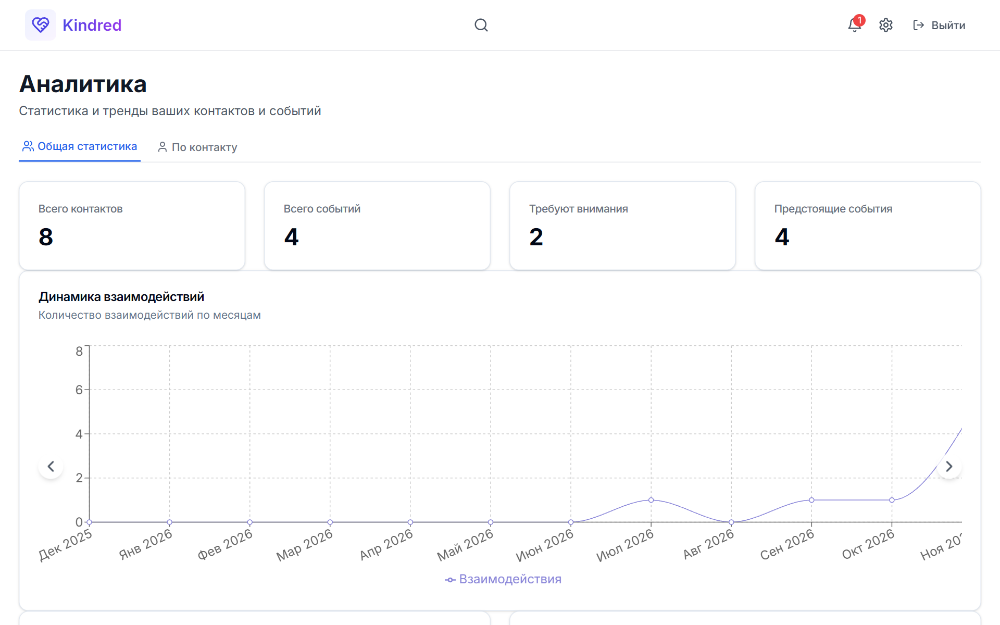
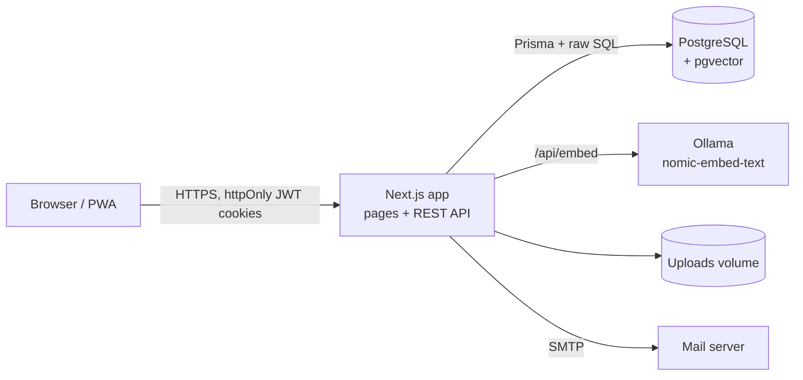

# Kindred — personal CRM

[Русская версия](README.ru.md)


A web app that helps you remember the people in your life: who they are, how
you met, when you last talked, what is coming up and how they are connected
to each other. Built as my bachelor's thesis project (graded 5/5) and later
reworked into a production-ready portfolio piece.



## Features

- **Contacts**: profile fields, avatars, tags, relationship type, personal notes,
  soft delete with a trash bin.
- **Timeline per contact**: notes, photos and reminders in a chat-like feed,
  plus a log of interactions (calls, meetings, messages) with mood and importance.
- **Relationships between people**: link two contacts ("sister" / "brother")
  and see the link from both sides.
- **Events**: types, participants, location on a map, recurrence rules,
  reminders, automatic archive of past events.
- **Calendar**: month view combining events, reminders and birthdays.
- **Reminders**: one-off or repeating (weekly … yearly); completing a repeating
  reminder schedules the next one. In-app notification bell.
- **Search and filters**: by name, city, tags, relationship type, upcoming
  events, "haven't talked for N days"; events by date range, type,
  participant, tags, location and attached media.
- **AI search**: semantic search over contacts, events, interactions and notes
  with pgvector and a local embedding model (Ollama, `nomic-embed-text`). Exact
  text matches are merged with vector matches, so it still works when the model
  is offline.
- **Analytics**: interaction dynamics, contacts that need attention,
  per-contact statistics.
- **Auth**: registration, JWT access/refresh tokens in httpOnly cookies,
  password reset by email.
- **PWA**: installable, with an offline fallback page.

| Contact page | AI search |
| --- | --- |
|  |  |
| **Calendar** | **Analytics** |
|  |  |

## Tech stack

| Layer | Technologies |
| --- | --- |
| Frontend | Next.js 16 (App Router), React 18, TypeScript, Tailwind CSS, shadcn/ui (Radix), Recharts, Leaflet |
| Backend | Next.js route handlers (REST), Zod validation, `jose` JWT, bcrypt, nodemailer, sharp |
| Database | PostgreSQL 16, pgvector, Prisma 5; triggers, views and full-text GIN indexes |
| AI | Ollama with `nomic-embed-text` (768-dim embeddings), cosine similarity search |
| Tooling | Vitest, ESLint, GitHub Actions, Docker / Docker Compose |

## Architecture



When a contact, event, interaction or note is saved, its text is embedded by
the local model and stored in a `vector(768)` column. A search query is
embedded the same way, compared with cosine distance in PostgreSQL and merged
with exact `ILIKE` matches. Every query is scoped to the current user.

The database schema (16 tables, 3 views) is in
[`prisma/schema.prisma`](prisma/schema.prisma); the full SQL including
triggers and indexes is the baseline migration in
[`prisma/migrations/0_init`](prisma/migrations/0_init/migration.sql).
An ER diagram is in [`docs/er-diagram.png`](docs/er-diagram.png).

## Getting started

### With Docker (recommended)

Requires Docker with ~4 GB of memory available.

```bash
cp .env.example .env
# set JWT_SECRET and REFRESH_TOKEN_SECRET, e.g.:
node -e "console.log(require('crypto').randomBytes(48).toString('hex'))"

docker compose up -d --build
```

Open http://localhost:3000. The first start downloads the embedding model
(~270 MB) and applies the database migrations automatically.

### Local development

Requires Node.js 22, PostgreSQL 16 with the `vector` extension and
[Ollama](https://ollama.com).

```bash
npm install
cp .env.example .env          # point DATABASE_URL to your database
ollama pull nomic-embed-text
npx prisma migrate deploy
npm run dev
```

Useful scripts:

| Command | What it does |
| --- | --- |
| `npm run dev` | development server |
| `npm run build && npm start` | production build |
| `npm test` | unit tests (Vitest) |
| `npm run lint` / `npm run typecheck` | static checks |
| `npm run embeddings:generate` | backfill embeddings for existing data |

## Testing

- Unit tests cover reminder recurrence, birthday calculation, search ranking,
  upload path validation and security configuration.
- CI runs lint, type checking, tests and a production build, applies the
  migrations to a fresh pgvector database and checks them against the Prisma
  schema, and builds the Docker image.
- Results of the load (k6), security (OWASP ZAP), Lighthouse and database
  tests carried out for the thesis are in [`docs/testing`](docs/testing).

## Project history

The commit history was rebuilt from the dated archives I kept while working on
the thesis (January–June 2026), so it shows how the project actually grew:
auth → contacts → tags → timeline → events → interactions and AI search →
testing.

After the defence I came back to it and fixed what I would not ship today:

- the production build failed (`useSearchParams` without `Suspense`);
- debug endpoints exposed secret details and JWT secrets had hardcoded fallbacks;
- a path traversal in the upload API allowed deleting arbitrary files;
- the Prisma migration was out of date, so a fresh database could not be created;
- interactions were counted twice (API and a database trigger both incremented);
- the event tag filter was silently ignored by the API.

I also added the parts of the original specification that were missing:
Docker deployment, PWA, relationships between people, calendar, repeating
reminders, notes in AI search, tests and CI.

## Known limitations

- Media attachments are images only (no video or documents yet).
- AI search is semantic similarity, not natural-language query parsing:
  "events with Peter in the last 3 years" is not turned into filters.
- `nomic-embed-text` is an English-first model; a multilingual model would
  rank Russian text better.
