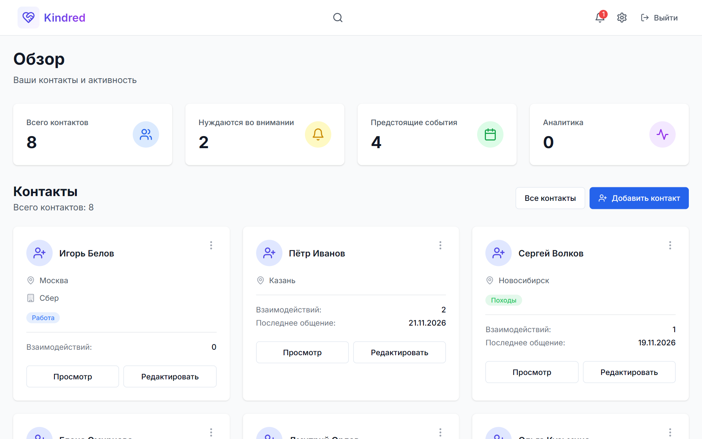
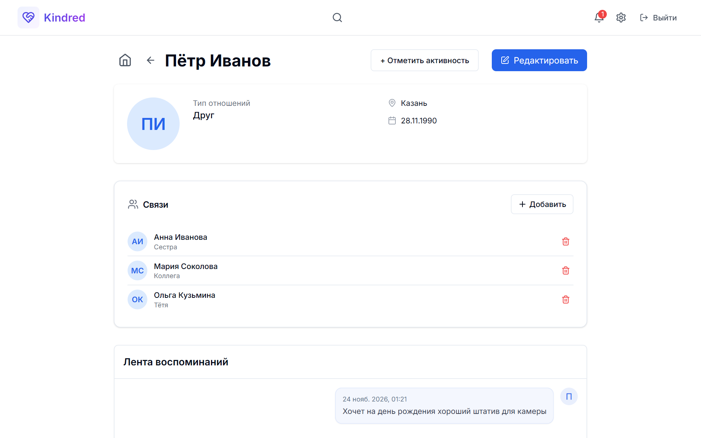
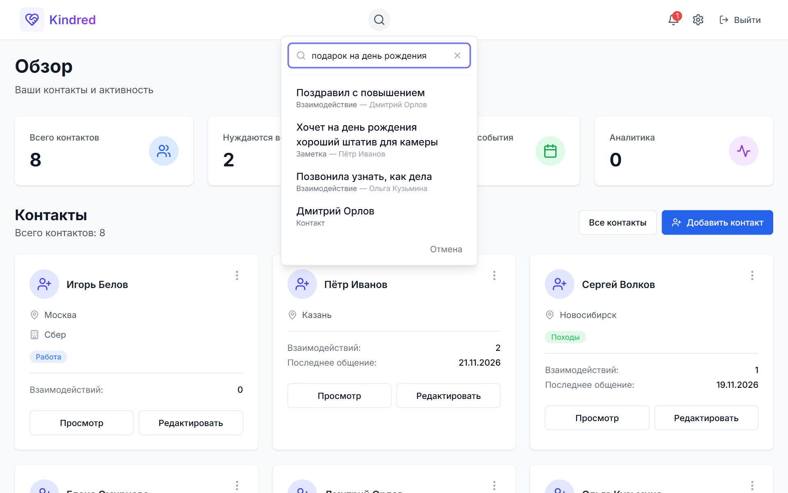
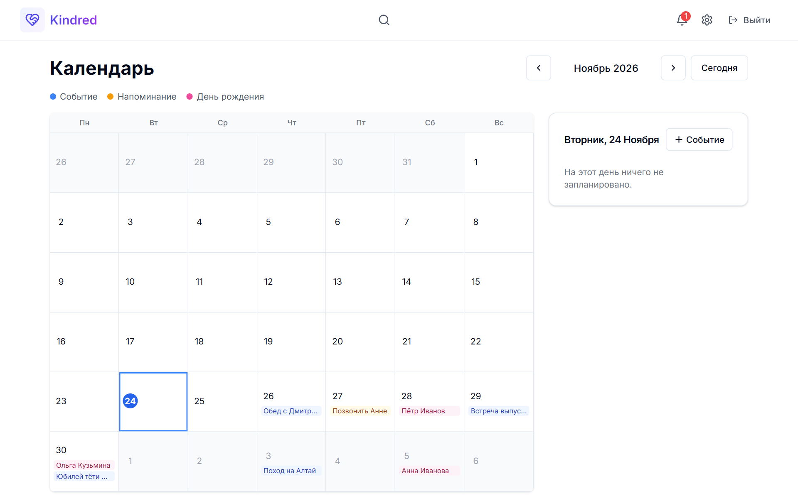
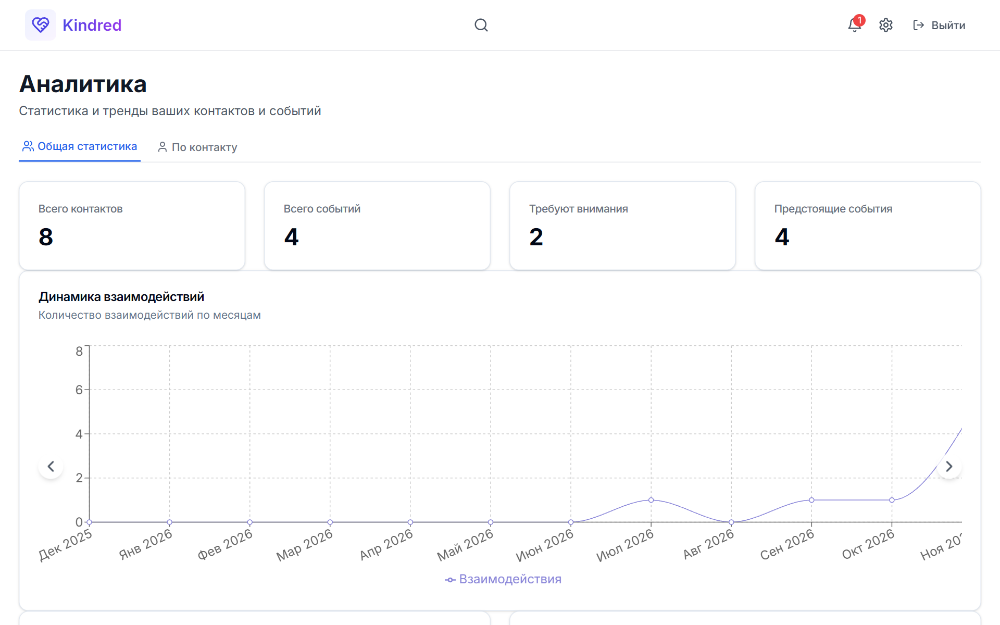
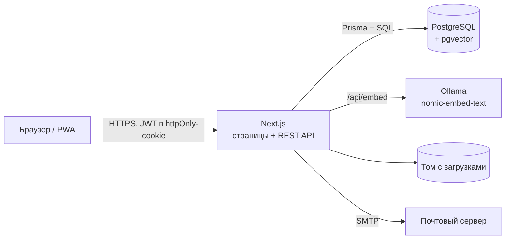

# Kindred — персональная CRM

[English version](README.md)


Веб-приложение, которое помогает помнить о людях вокруг: кто они, как вы
познакомились, когда последний раз общались, что впереди и как люди связаны
между собой. Это моя выпускная квалификационная работа (защищена на «отлично»),
которую я позже довёл до состояния, готового к развёртыванию.



## Возможности

- **Контакты**: карточка с полями, аватар, теги, тип отношений, личные заметки,
  корзина с восстановлением.
- **Лента по контакту**: заметки, фото и напоминания в виде чата, плюс журнал
  взаимодействий (звонки, встречи, переписка) с настроением и важностью.
- **Связи между людьми**: можно связать два контакта («сестра» / «брат»), связь
  видна с обеих сторон.
- **События**: типы, участники, место на карте, повторения, напоминания,
  автоматический архив прошедших событий.
- **Календарь**: месяц с событиями, напоминаниями и днями рождения.
- **Напоминания**: разовые и повторяющиеся (от раза в неделю до раза в год).
  Когда закрываешь повторяющееся напоминание, создаётся следующее. Уведомления
  в интерфейсе.
- **Поиск и фильтры**: по имени, городу, тегам, типу отношений, наличию
  предстоящих событий, «не общался N дней»; события по датам, типу, участнику,
  тегам, месту и наличию медиа.
- **AI-поиск**: семантический поиск по контактам, событиям, взаимодействиям
  и заметкам на pgvector и локальной модели (Ollama, `nomic-embed-text`).
  Точные совпадения объединяются с векторными, поэтому поиск работает и без
  модели.
- **Аналитика**: динамика общения, контакты, требующие внимания, статистика
  по контакту.
- **Авторизация**: регистрация, JWT access/refresh в httpOnly-cookie,
  восстановление пароля по почте.
- **PWA**: приложение можно установить, есть офлайн-страница.

| Карточка контакта | AI-поиск |
| --- | --- |
|  |  |
| **Календарь** | **Аналитика** |
|  |  |

## Стек

| Слой | Технологии |
| --- | --- |
| Фронтенд | Next.js 16 (App Router), React 18, TypeScript, Tailwind CSS, shadcn/ui (Radix), Recharts, Leaflet |
| Бэкенд | Route handlers Next.js (REST), валидация Zod, JWT на `jose`, bcrypt, nodemailer, sharp |
| База данных | PostgreSQL 16, pgvector, Prisma 5; триггеры, представления, полнотекстовые GIN-индексы |
| AI | Ollama с моделью `nomic-embed-text` (эмбеддинги 768), поиск по косинусной близости |
| Инструменты | Vitest, ESLint, GitHub Actions, Docker / Docker Compose |

## Архитектура



При сохранении контакта, события, взаимодействия или заметки текст
превращается в эмбеддинг локальной моделью и сохраняется в колонку
`vector(768)`. Поисковый запрос обрабатывается так же, сравнивается
по косинусному расстоянию в PostgreSQL и объединяется с точными
совпадениями `ILIKE`. Каждый запрос ограничен данными текущего пользователя.

Схема базы (16 таблиц, 3 представления) — в
[`prisma/schema.prisma`](prisma/schema.prisma), полный SQL с триггерами
и индексами — в базовой миграции
[`prisma/migrations/0_init`](prisma/migrations/0_init/migration.sql).
ER-диаграмма — [`docs/er-diagram.png`](docs/er-diagram.png).

## Запуск

### Через Docker (рекомендуется)

Нужен Docker с ~4 ГБ свободной памяти.

```bash
cp .env.example .env
# задайте JWT_SECRET и REFRESH_TOKEN_SECRET, например:
node -e "console.log(require('crypto').randomBytes(48).toString('hex'))"

docker compose up -d --build
```

Откройте http://localhost:3000. При первом запуске скачается модель
эмбеддингов (~270 МБ), а миграции базы применятся автоматически.

### Локальная разработка

Нужны Node.js 22, PostgreSQL 16 с расширением `vector` и
[Ollama](https://ollama.com).

```bash
npm install
cp .env.example .env          # укажите в DATABASE_URL свою базу
ollama pull nomic-embed-text
npx prisma migrate deploy
npm run dev
```

Полезные команды:

| Команда | Что делает |
| --- | --- |
| `npm run dev` | сервер разработки |
| `npm run build && npm start` | production-сборка |
| `npm test` | юнит-тесты (Vitest) |
| `npm run lint` / `npm run typecheck` | статические проверки |
| `npm run embeddings:generate` | пересчитать эмбеддинги для существующих данных |

## Тестирование

- Юнит-тесты покрывают повтор напоминаний, расчёт дней рождения, ранжирование
  поиска, проверку путей загрузок и настройки безопасности.
- CI запускает линтер, проверку типов, тесты и production-сборку, применяет
  миграции к чистой базе с pgvector и сверяет их со схемой Prisma, собирает
  Docker-образ.
- Результаты нагрузочного (k6), security- (OWASP ZAP), Lighthouse- и
  БД-тестирования, проведённого для диплома, лежат в [`docs/testing`](docs/testing).

## История проекта

История коммитов восстановлена из архивов с датами, которые я сохранял во время
работы над дипломом (январь–июнь 2026), поэтому видно, как проект рос на самом
деле: авторизация → контакты → теги → лента → события → взаимодействия
и AI-поиск → тестирование.

После защиты я вернулся к проекту и исправил то, с чем не стал бы выпускать его
сейчас:

- production-сборка падала (`useSearchParams` без `Suspense`);
- debug-эндпоинты раскрывали сведения о секретах, у JWT-секретов были
  захардкоженные значения по умолчанию;
- уязвимость path traversal в API загрузок позволяла удалить произвольный файл;
- миграция Prisma устарела, и с нуля база не создавалась;
- взаимодействия считались дважды (счётчик увеличивали и API, и триггер базы);
- фильтр событий по тегам молча игнорировался API.

Также я добавил то, чего не хватало по исходному ТЗ: развёртывание в Docker,
PWA, связи между людьми, календарь, повторяющиеся напоминания, заметки
в AI-поиске, тесты и CI.

## Ограничения

- Медиа — только изображения (видео и документов пока нет).
- AI-поиск ищет по смысловой близости, но не разбирает запрос на фильтры:
  «события с Петей за последние 3 года» не превращается в условия.
- `nomic-embed-text` обучена в основном на английском; мультиязычная модель
  ранжировала бы русский текст лучше.

## Лицензия

[MIT](LICENSE)
